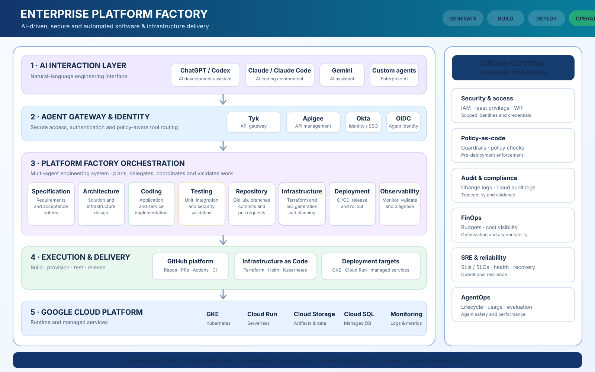

# Enterprise Platform Factory

**AI-driven, secure and automated software and infrastructure delivery on Google Cloud Platform (GCP).**

The Enterprise Platform Factory turns natural-language requirements into governed, tested, deployable applications and cloud infrastructure. It provides a reusable engineering system that can work with multiple AI assistants while keeping execution, identity, policy enforcement and cloud permissions under enterprise control.



## Interactive demo

Open the [Enterprise Platform Factory interactive demo](demo/index.html) to explore the provider-neutral control plane, build-request workflow, approval gates, identity and policy controls, architecture layers, integrations and simulated audit trail.

The demo is a standalone HTML experience. All workflow actions and status metrics are simulated; it does not connect to live AI providers, GitHub, Terraform or cloud accounts.

## Trust and operations control plane demo

Explore the [FinOps, Governance, Security and Monitoring demo](demo/platform-controls.html) for the cross-cutting control plane that should govern every factory workload. It includes cost allocation and optimization, governance coverage and evidence, zero-trust security posture, SLOs and telemetry, policy enforcement points, and an audit evidence ledger.

This is a standalone prototype with synthetic metrics and simulated controls; it does not connect to live cloud accounts, monitoring systems, identity providers or policy engines.

## Conversational build and provisioning workflow

The interactive build demo supports a conversational entry point using text and browser speech recognition where available. The guided flow separates intent discovery and clarification from blueprint generation and requester confirmation. Only after the blueprint is confirmed can the workflow hand the specification to the Infrastructure Engine for a Terraform plan; policy checks and human approval remain required before apply.

The demo simulates these interactions and does not invoke a live speech service, AI model, Terraform runner or cloud account.

## Vision

Create a standardized factory for moving from **idea to production** through AI-assisted specification, architecture, coding, testing, repository management, infrastructure provisioning, deployment and operations.

## Reference architecture

The platform is organized into the following layers:

1. **AI interaction layer** — ChatGPT/Codex, Claude/Claude Code, Gemini and custom enterprise agents provide the natural-language development interface.
2. **Agent gateway and identity** — Tyk or Apigee provide API ingress and management; Okta provides identity and SSO; agent identity and OAuth/OIDC govern agent access.
3. **Platform factory orchestration** — coordinates specialized engineering agents and manages task state, dependencies, approvals and hand-offs.
4. **Execution and delivery** — GitHub repositories, pull requests and Actions; Terraform, Helm and Kubernetes; build, release and deployment workflows.
5. **Cloud runtime** — GKE, Cloud Run, Cloud Storage, Cloud SQL, Cloud Monitoring, Cloud Logging and IAM on GCP.
6. **Cross-cutting governance** — security and least privilege, Workload Identity Federation (WIF), policy-as-code, audit and compliance, FinOps, SRE and AgentOps.

## Specialized engineering agents

| Agent | Responsibility | Typical outputs |
|---|---|---|
| Specification Agent | Converts business requirements into clear, testable specifications | User stories, acceptance criteria, API and NFR specifications |
| Architecture Agent | Designs solution and infrastructure architecture | Context diagrams, component views, ADRs, architecture decisions |
| Coding Agent | Generates and modifies application code | Services, APIs, UI, Dockerfiles and configuration |
| Test Agent | Validates functional, integration and security requirements | Unit, integration, contract and security tests |
| Repository Agent | Manages source control and collaboration | Repositories, branches, commits, pull requests and reviews |
| Infrastructure Agent | Defines infrastructure as code | Terraform modules, environment configuration and plans |
| Deployment Agent | Coordinates build, release and rollout | CI/CD workflows, Helm releases and deployment evidence |
| Observability Agent | Checks runtime health and diagnoses issues | Logs, metrics, traces, alerts and operational reports |

## Example workflow

A user can request:

> Create a FastAPI application, provision GKE on GCP, configure CI/CD and deploy it securely.

The factory then coordinates:

1. Clarify requirements and produce an implementation plan.
2. Design the application, platform dependencies and security controls.
3. Generate application code, tests, container definitions and Terraform.
4. Create or update a GitHub repository and submit changes for review.
5. Run CI checks, security scans and Terraform plan.
6. Obtain required approvals before infrastructure changes.
7. Authenticate GitHub Actions to GCP using OIDC and Workload Identity Federation.
8. Provision infrastructure and deploy the application.
9. Validate health, publish deployment evidence and enable monitoring.

## Technology integrations

| Capability | Candidate technologies |
|---|---|
| AI assistants | ChatGPT, Codex, Claude Code, Gemini, custom agents |
| Agent integration | MCP, agent gateway, OAuth/OIDC |
| Identity | Okta, Google Cloud IAM, Workload Identity Federation |
| Source control | GitHub, GitHub Apps, GitHub Actions |
| Infrastructure as code | Terraform |
| Containers and orchestration | Docker, Kubernetes, GKE, Helm |
| Runtime | GKE, Cloud Run |
| Observability | Cloud Monitoring, Cloud Logging, OpenTelemetry-compatible tooling |
| Governance | Policy-as-code, audit logging, security controls, FinOps and AgentOps |

These are integration options, not assumptions that every component is already deployed.

## Security and governance principles

- Treat the AI agent, human requester and cloud workload as distinct identities.
- Use least-privilege permissions and environment-specific service accounts.
- Prefer GitHub OIDC with GCP Workload Identity Federation over long-lived service-account keys.
- Restrict federation trust to approved repositories, branches and workflows.
- Require review and explicit approval for production changes.
- Run policy, security, quality and infrastructure checks before deployment.
- Protect Terraform state and use controlled state access and locking.
- Capture source changes, approvals, deployment records and cloud audit events.
- Apply budgets, quotas, monitoring, alerting and rollback procedures.

**The AI proposes and coordinates changes; a governed execution plane validates authorization and policy before performing consequential operations.**

## Suggested repository structure

```text
enterprise-platform-factory/
├── README.md
├── docs/
│   ├── images/
│   │   └── enterprise-platform-factory.svg
│   ├── architecture/
│   ├── design/
│   └── decisions/
├── agents/
├── orchestration/
├── templates/
├── infrastructure/
│   ├── modules/
│   └── environments/
├── applications/
├── tests/
└── .github/
    └── workflows/
```

## Implementation roadmap

| Phase | Focus | Outcome |
|---|---|---|
| 1 | AI coding and GitHub integration | Generate, test and submit code changes |
| 2 | Terraform and GCP WIF | Secure, repeatable infrastructure provisioning |
| 3 | CI/CD and deployment automation | Governed application delivery |
| 4 | MCP and agent gateway | Standardized tool access for multiple AI agents |
| 5 | Multi-agent orchestration | Coordinated end-to-end engineering workflows |
| 6 | Governance and AgentOps | Production controls, evidence and continuous improvement |

## Initial proof of concept

Build one complete vertical slice:

**Natural-language request → specification → FastAPI code → tests → GitHub pull request → Terraform plan → approval → GCP deployment → health validation.**

Start with a non-production GCP environment, narrowly scoped identities and explicit approval gates. Expand to additional environments and cloud providers only after the workflow is observable and repeatable.

## Project status

This repository establishes the reference architecture and initial documentation. Implementation components, runnable examples, Terraform modules and CI/CD workflows will be added incrementally.

## License

License to be determined.

## Product specification and design

The end-to-end product baseline is documented in:
- [Product specification](docs/product-specification.md) — vision, personas, capability map, user journey, functional and non-functional requirements, first-class entities, guardrails, MVP and roadmap.
- [Target architecture](docs/architecture/target-architecture.md) — six-plane architecture, trust boundaries, identity, workflow/task contracts, event/data architecture, GCP-first deployment topology, security and resilience.
- [Product experience and interaction design](docs/design/product-experience-design.md) — navigation, screen-level behavior, conversational flow, approval UX, design system and acceptance criteria.

## End-to-end product experience demo

Open [demo/product-experience.html](demo/product-experience.html) for the consolidated EPF product experience: command center, conversational build, blueprint confirmation, architecture, lifecycle, engineering engines, first-class entity catalog, governance, security, FinOps, observability and integrations.

This is a standalone HTML prototype with synthetic metrics and simulated client-side actions. It does not invoke a live model or connect to GitHub, Terraform, identity providers, policy engines or cloud accounts.


## Design and development workbench

The [Design & Development Index](docs/DESIGN-DEVELOPMENT-INDEX.md) is the entry point for the next design phase. It links starter documents for the enterprise meta-model, entity catalog, relationships, lifecycle, component/deployment/agentic/execution architecture, engineering engines, shared platform services, integrations, APIs, events, data, testing and discussion traceability.

These are deliberately starter documents: they capture scope, candidate models, design questions and expected deliverables so detailed design and implementation can be continued later. They are not all approved or implementation-ready specifications.

