# AI Platform Factory — Technical Reference Architecture

This reference describes a secure, provider-neutral engineering factory using ChatGPT/Codex or Claude Code, GitHub MCP, Tyk, Okta, GitHub Actions, Terraform, GCP Workload Identity Federation (WIF), and GKE. The accompanying [interactive demo](./index.html) simulates the first non-production delivery path; it does not connect to these services.

## 1. Goals and operating model

Turn an authenticated engineering request into a reviewed, tested, and deployable change while keeping model access separate from authorization and execution. AI assistants propose and coordinate work; the platform validates identity, scope, policy, and approvals before tools or deployment workflows act.

The initial workload is a small containerized FastAPI service deployed to a non-production GKE environment. This is a reference pattern, not a claim that the integrations or cloud resources are already configured.

### Invariants

- Humans, AI clients, MCP servers, GitHub Actions jobs, GCP service accounts, and application workloads have distinct identities.
- A model, prompt, or agent-provided identifier never grants permission.
- Tools are explicitly allowlisted, schema-validated, environment-scoped, and audited.
- Source and infrastructure changes are versioned, reviewed, and tested before deployment.
- Terraform apply requires approval of the exact plan digest; a changed plan requires a new approval.
- Interactive coding agents never receive production credentials or long-lived GCP keys.
- Policy and authorization failures fail closed for consequential actions.

## 2. Logical architecture

```mermaid
flowchart LR
  H[Human engineer] -->|Okta SSO / OIDC| AI[ChatGPT / Codex<br/>or Claude Code]
  AI -->|bounded task / approved MCP client| TYK[Tyk API gateway]
  TYK -->|authenticated, limited route| ORCH[Factory orchestrator<br/>policy · task state · approval]
  ORCH -->|narrow GitHub tools| MCP[GitHub MCP server]
  MCP -->|GitHub App installation token| GH[Allowlisted GitHub repository]
  GH --> PR[Pull request + required review]
  PR --> ACT[GitHub Actions]
  ACT -->|tests · scans · Terraform plan| PLAN[Immutable plan + policy result]
  HUMAN[Authorized approver] -->|GitHub environment approval| APPLY[Protected apply job]
  PLAN --> APPLY
  ACT -->|OIDC token, constrained claims| WIF[GCP Workload Identity Federation]
  APPLY -->|short-lived impersonation| SA[Non-prod deploy service account]
  WIF --> SA
  SA -->|Terraform apply · deploy| GKE[GKE non-production]
  GKE --> OBS[Health checks · logs · audit evidence]
  APPLY --> OBS
```



### Component responsibilities

| Component | Responsibility | Must not do |
|---|---|---|
| ChatGPT/Codex or Claude Code | Interactive authoring and task submission through the approved client/tool contract | Hold production credentials or decide its own authorization |
| Okta | Workforce SSO and user authentication; issue or broker identity for supported clients | Substitute for GitHub App or GCP workload authorization |
| Tyk | Factory/MCP API ingress, route policy, rate limiting, request-size controls, and correlation | Act as the source of project policy or replace Kubernetes service ingress |
| Factory orchestrator | Validate typed tasks; authorize capabilities; maintain durable state; request approval; record provenance | Give unrestricted shell, repository, or cloud access to an agent |
| GitHub MCP server | Expose a small, schema-constrained set of repository operations | Accept arbitrary repositories or use a user-wide, long-lived token |
| GitHub App | Provide repository-scoped installation tokens for approved repository operations | Have organization-owner or broad administration permissions without a separate need |
| GitHub Actions | Run deterministic tests, scans, plans, protected apply, deployment, and verification | Make secrets broadly available to all jobs or use a service-account key |
| Terraform | Define infrastructure and produce a reviewable plan; apply the approved plan in CI | Apply directly from an interactive agent workspace |
| GCP WIF | Exchange eligible GitHub OIDC assertions for short-lived GCP credentials | Trust an entire GitHub organization without repository/ref/environment constraints |
| GKE | Run the application with workload identity, namespace/resource controls, and observable rollouts | Share the CI deployment identity with application pods |

Tyk and Kubernetes Gateway API/Ingress serve different boundaries: Tyk can protect factory and MCP APIs (and optionally an application API edge); cluster ingress routes traffic into GKE. Do not deploy overlapping gateways without an explicit traffic and ownership boundary.

## 3. Trust boundaries and identity flows

### TB1 — Human to AI client

The user authenticates through the organization’s Okta-backed sign-in flow where supported. The client receives only the scopes required to submit a task or invoke approved tools. User identity and project membership are validated by the factory; the model context is untrusted input.

### TB2 — AI client to Tyk and factory

Expose the factory/MCP endpoint over TLS through Tyk. Validate issuer, audience, token expiry, scopes, project, operation class, and rate limits. Propagate a server-generated task/trace ID. Do not accept client-supplied identity headers as proof of identity. If the selected client cannot use the organization’s preferred Okta flow, broker access through a supported integration rather than weakening gateway validation.

### TB3 — Agent runtime to GitHub MCP

The orchestrator authorizes each proposed tool call against the task envelope, repository allowlist, and operation policy. The MCP server validates arguments and uses a GitHub App installation token scoped to the approved repository and permissions. Keep read, branch/PR write, and destructive/admin operations separate; omit destructive operations from the initial capability set. Redact credentials and sensitive outputs. Repository content and tool results are untrusted data, including instructions that resemble prompts.

### TB4 — GitHub Actions to GCP

Only the protected deployment job requests an OIDC token (`id-token: write`). A GCP WIF provider maps and validates claims, with conditions restricted to the expected GitHub owner/repository and protected ref and/or environment. The federated principal may impersonate only the intended environment-specific service account. Separate plan and apply permissions where practical; do not make a plan job able to apply. Use short-lived credentials and no downloadable service-account keys.

The apply job must consume the reviewed plan artifact and verify its integrity/digest. Configure a protected GitHub Environment with required reviewers. The approval is for the exact artifact; if a plan is regenerated or its digest changes, require another approval.

### TB5 — Deployment identity to GKE

Use a deployment service account with the minimum roles required to provision the target resources and update the intended cluster/namespace. Keep application runtime permissions separate and use GKE Workload Identity Federation for Kubernetes workloads to access Google Cloud APIs. Apply network policy, namespace RBAC, admission policy, image provenance/scan requirements, and secret access restrictions appropriate to the workload.

### TB6 — Production operations

Use separate production project, Terraform state, WIF conditions, service account, GitHub Environment, and approver group. Production requires a distinct explicit approval and operating procedure. There is no path from the interactive agent to production apply credentials.

## 4. End-to-end workflow

1. **Authenticate and authorize:** Okta authenticates the requester. The factory checks project ownership/membership, repository allowlist, target environment, and request limits.
2. **Specify:** Convert the request into a versioned task specification with acceptance criteria, NFRs, data classification, allowed tools, repository, target environment, deadline, and required approvals. Ask for clarification when a required value is ambiguous.
3. **Plan:** Create a dependency graph and select versioned capabilities. Persist task state and a correlation ID. Require owner approval of the specification/design where repository or policy requires it.
4. **Generate in a bounded workspace:** Agents generate application, tests, container assets, and Terraform changes without cloud credentials. Treat repository files, MCP results, and generated artifacts as untrusted until validated.
5. **Create a reviewable change:** GitHub MCP uses the scoped GitHub App to create a branch/commit and pull request in an allowlisted repository. Branch protection and code-owner policies remain authoritative.
6. **Run deterministic CI:** GitHub Actions runs tests, lint, dependency and secret scans, container build, IaC formatting/validation, and policy checks. Retain reports and immutable artifacts with commit and workflow provenance.
7. **Plan infrastructure:** A constrained CI job initializes Terraform against the environment-specific remote state and emits a saved plan. Evaluate policy-as-code for IAM scope, network exposure, regions, required labels, and destructive changes. Publish the exact plan digest and human-readable summary.
8. **Approve:** A required reviewer approves through a protected GitHub Environment (or equivalent approval service). Bind the decision to the plan digest, target project/environment, commit, and expiry. Reject or changed plan means no apply.
9. **Federate and apply:** The protected job obtains GitHub OIDC only after approval. GCP WIF verifies repository/ref/environment claims and issues short-lived credentials for the non-production deploy identity. Apply the saved, approved plan; deploy the built artifact tied to the reviewed commit.
10. **Verify and report:** Wait for GKE rollout; run smoke/health checks and configured SLO checks. Record image digest, commit, plan digest, approval, workflow run, cloud audit correlation, result, and rollback reference in the task report.

## 5. GitHub Actions and WIF controls

Illustrative workflow boundaries (not a drop-in workflow; claim names, action SHAs, roles, and resource identifiers must be validated for the organization):

```yaml
permissions:
  contents: read

jobs:
  validate:
    permissions:
      contents: read
    # Tests, scans, Terraform validate and plan. No GCP apply permission.

  apply-nonprod:
    needs: validate
    environment: non-production
    permissions:
      contents: read
      id-token: write
    # Protected environment approval, then WIF authentication and saved-plan apply.
```

Before production use:

- Pin third-party Actions to reviewed immutable commit SHAs; restrict `GITHUB_TOKEN` permissions per job.
- Configure WIF attribute mapping/conditions using verified token claims. Enforce owner, exact repository, protected branch/tag and/or protected environment; avoid broad wildcard trust.
- Grant `roles/iam.workloadIdentityUser` (or the required supported federation binding) only to the intended principal set on the target service account.
- Split Terraform plan, non-production apply, and production apply identities. Apply least-privilege resource roles rather than project Owner/Editor.
- Isolate Terraform state by project/environment; use an encrypted remote backend, locking, access logs, and versioning/retention. Never expose state to the agent.
- Bind the apply workflow to a saved plan from the validated commit; verify artifact integrity and invalidate approval on any change.
- Configure environment reviewers, prevent self-approval where required, and document emergency/break-glass access.
- Store application secrets in Secret Manager or an approved vault; fetch at runtime using workload identity. Do not place secrets in prompts, Terraform source, logs, or artifacts.

## 6. Contracts and task state

Use the contracts in [Agent and Tool Contracts](../docs/architecture/agent-and-tool-contracts.md). At minimum, each task has:

```json
{
  "task_id": "uuid",
  "project_id": "payments-api",
  "requested_by": "authenticated-subject",
  "capability": "service.scaffold/v1",
  "environment": "nonprod",
  "input_artifact_refs": [],
  "constraints": {
    "repositories": ["org/payments-api"],
    "tools": ["github.read", "github.branch.create", "github.pull_request.create"],
    "regions": ["approved-region"]
  },
  "approval_requirements": ["repository-review", "terraform-apply"],
  "trace_id": "correlation-id",
  "deadline": "bounded-deadline",
  "retry_policy": "bounded-policy"
}
```

Persist and validate lifecycle transitions:

`DRAFT → VALIDATED → PLANNED → AWAITING_APPROVAL → RUNNING → SUCCEEDED | FAILED | CANCELLED`

`BLOCKED` is used when a dependency, permission, or approval is missing. Agent/tool outputs are structured: status, artifact references and digests, validation evidence, warnings/errors, and next actions. Retry only typed retryable failures, with bounded attempts and idempotent operations.

## 7. Deployment topology

| Boundary | Recommended isolation |
|---|---|
| Developer/agent | Local or managed workspace; no production credential material; task-scoped tool authorization |
| Factory services | Private service network where practical; Tyk ingress; separate orchestrator, MCP server, policy, state, and audit identities |
| GitHub control plane | Approved organization/repositories; protected branches and environments; reviewed reusable workflows |
| GCP non-production | Dedicated project(s), state backend, deploy service account, GKE cluster/namespace, quotas, and budget |
| GCP production | Separate project(s), state, identity trust, protected environment, approvers, and release policy |
| Evidence/operations | Centralized, access-controlled audit and monitoring; retention and redaction policy; task/trace correlation |

## 8. Required observability and evidence

Emit structured events for task creation, authorization decision, plan creation, agent and tool invocation, policy evaluation, PR/commit, approval requested/granted/denied, plan digest, credential federation, apply, deployment, health check, rollback, and task closure.

Every event should carry task/trace ID, authenticated actor, capability/tool version, repository and commit, environment, artifact digest, policy/approval reference, timestamp, outcome, and relevant workflow/cloud correlation IDs. Never log access tokens, secret values, or unnecessary prompt/source payloads. Alert on policy denial spikes, unexpected federation, failed deployments, drift, and suspicious tool use.

## 9. Minimum acceptance checks

- [ ] Requester is authenticated and project/repository/environment authorization is enforced.
- [ ] Only allowlisted, schema-validated GitHub MCP operations are available; writes are attributable.
- [ ] Pull request and required CI checks pass; branch protection remains enabled.
- [ ] Terraform plan and policy output are retained and tied to a commit and immutable digest.
- [ ] Apply is impossible before an authorized human approval of that exact digest.
- [ ] WIF rejects tokens from unapproved repository/ref/environment claims.
- [ ] No long-lived GCP key is present in GitHub, agent workspace, logs, or artifacts.
- [ ] The deployment identity cannot modify production; runtime identity is distinct from CI.
- [ ] GKE rollout and health checks are verified; failure/rollback paths are documented.
- [ ] Audit events are correlated end-to-end, access controlled, and redacted.

## 10. Architecture decisions to finalize

1. Orchestrator framework and durable workflow/state store.
2. Supported MCP client transport and identity hand-off for each assistant.
3. Tyk deployment model, API ownership, and exact factory/MCP routes.
4. Okta OAuth/OIDC app, groups, claims, session, and token policies.
5. GitHub App permissions, installation boundary, and token broker.
6. WIF provider, claim mapping/conditions, and service-account impersonation bindings.
7. Terraform backend, state locking, plan retention, and promotion model.
8. GKE cluster ownership, ingress, network policy, workload identity, and release controller.
9. Image registry, signing/attestation, provenance, and admission policy.
10. Audit retention, observability platform, SLOs, incident response, and FinOps ownership.

## 11. Demo behavior and limitations

Open `index.html` directly in a modern browser or serve the `demo-copilot` directory as static files. Select ChatGPT/Codex or Claude Code and start the run. The workflow advances locally, pauses after Terraform plan for approval or rejection, then simulates WIF, GKE deployment, and health verification. Rejecting the plan proves that apply is blocked. Reset starts a fresh simulation.

The demo does not authenticate, call an LLM, open a pull request, run Terraform, access GitHub/Tyk/Okta/GCP, or perform a deployment. Identifiers, events, policy outcomes, plan digest, and approval are illustrative. Production integrations need environment-specific implementation, threat modeling, permissions review, and validation.
