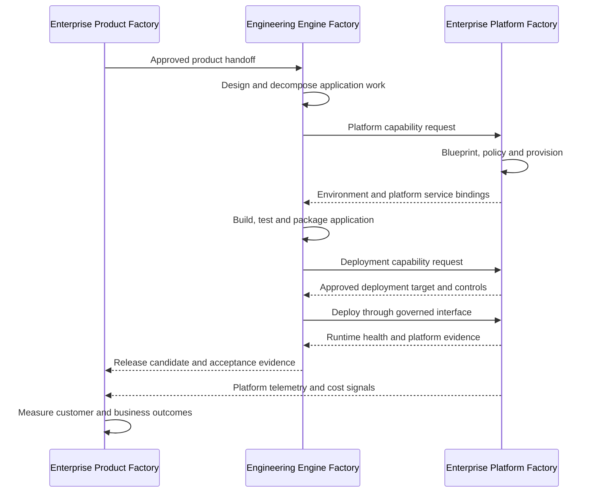

# Enterprise Factory Ecosystem — EPF-Platform Integration Contract

**Version:** 1.0.0-draft  
**Owner:** Enterprise Platform Factory (EPF-Platform)

## 1. Purpose

Define how Enterprise Platform Factory participates in the three-factory ecosystem:

- Enterprise Product Factory defines the product opportunity, customer problem, strategy, product baseline and measurable outcomes.
- Enterprise Engineering Factory (Engineering Engine Factory) implements and validates application software.
- Enterprise Platform Factory provides reusable platform blueprints, infrastructure, cloud foundations, shared data/API/AI capabilities, deployment services and platform operations.

EPF-Platform is not the owner of product discovery or application source-code generation. It provides governed platform capabilities to product and engineering delivery teams.

## 2. Responsibility boundaries

| Capability | Product Factory | Engineering Engine Factory | EPF-Platform |
|---|---|---|---|
| Product opportunity, strategy and PRD | Accountable | Consumer | Consumer |
| Application technical design | Consulted | Accountable | Consulted |
| Application source, tests and packages | Consumer | Accountable | Not owner |
| Shared platform architecture and blueprints | Consumer | Consumer | Accountable |
| Cloud foundation and network provisioning | Consumer | Consumer | Accountable |
| Shared data platform services | Consumer | Integrates | Accountable |
| Shared API gateway / platform API services | Consumer | Integrates | Accountable |
| Application API implementation | Product input | Accountable | Platform API capabilities |
| Application deployment package | Acceptance | Accountable | Runtime/deployment platform |
| Platform SLO, operations and cost | Consumer | Consumer | Accountable |
| Product adoption and business outcomes | Accountable | Provides release evidence | Provides platform telemetry |

## 3. Platform capability request

Engineering Factory and approved Product Factory workflows may request platform capabilities using a typed request.

Required fields:
- request_id, consumer_factory, tenant_id, product_id/project_id
- capability_id and acceptable version range
- target environment and region
- workload classification and criticality
- compute, storage, data, API, AI and network requirements
- identity, secret and connectivity requirements
- SLO, resilience, observability and recovery objectives
- budget/cost ceiling and cost-center labels
- policy context, requester and approval references

EPF-Platform returns:
- accepted/rejected/clarification status
- selected blueprint and version
- environment and service bindings
- plan and provisioning status
- identity and connectivity instructions
- policy and approval outcomes
- cost estimate and ownership metadata
- operational SLO, telemetry and support references

## 4. Cross-factory workflow

## 5. Platform service contract boundaries

EPF-Platform exposes capabilities, not unrestricted infrastructure credentials. Consumers request an approved capability or deployment operation. The platform control plane evaluates identity, authorization, policy, quotas, budget, environment and approval requirements before execution.

The platform factory owns Terraform modules, environment templates, cloud resource provisioning, shared platform APIs, network/identity/security foundations, runtime services and platform operations. Consumer factories own their product requirements and application artifacts.

## 6. Integration principles

- Version all request/response schemas and events.
- Use stable artifact IDs and immutable version references.
- Do not permit direct cross-repository database access.
- Apply least privilege and tenant/environment scoping.
- Separate plan from apply; production apply requires explicit approval.
- Use short-lived federated identities, not embedded credentials.
- Capture correlation IDs, policy decisions, costs and evidence.
- Contract tests must run before integration changes are accepted.

## 7. Initial integration milestones

1. Publish PlatformCapabilityRequest and PlatformCapabilityBinding schemas.
2. Define capability catalog IDs and versioning.
3. Provide a mock platform capability adapter for EEF local development.
4. Expose blueprint selection and plan APIs.
5. Add approval-gated provisioning and deployment interfaces.
6. Return telemetry, cost and compliance evidence to consumers.
7. Add end-to-end contract tests across all three repositories.

## 8. Explicit non-goals

This integration does not merge the three factories into one monolith, centralize all source code in EPF-Platform, or delegate product and application ownership to the platform team. The factories remain independently versioned and communicate through governed contracts.
