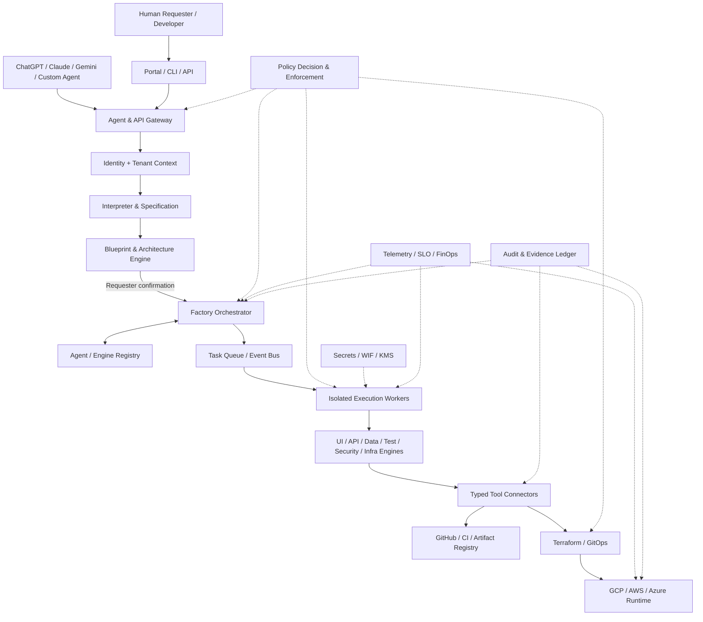
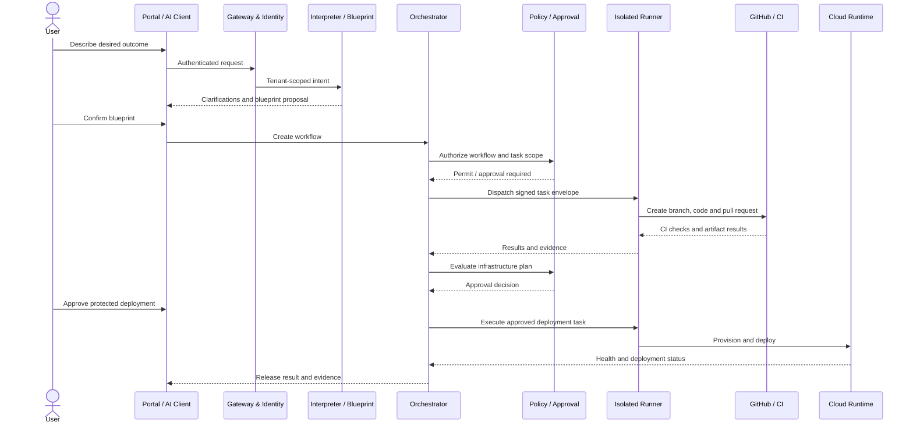

# Enterprise Platform Factory — Target Architecture

## 1. Purpose and scope

This document defines the target logical and deployment architecture for EPF. It complements the product specification and existing reference architecture with explicit planes, trust boundaries, component responsibilities, execution flows, identity patterns, data/event architecture and deployment topology.

## 2. Architectural principles

1. Separate reasoning, control, execution and runtime trust domains.
2. Treat every agent as an untrusted or semi-trusted workload until authenticated and authorized.
3. Keep privileged tools behind typed connectors and policy enforcement points.
4. Make workflows durable, event-driven, resumable and idempotent.
5. Use immutable/versioned artifacts and explicit provenance.
6. Make blueprints and engines composable, certified and versioned.
7. Enforce tenant isolation in control and execution planes.
8. Keep provider-specific services behind adapters.
9. Make policy, FinOps, security, observability and audit cross-cutting capabilities.
10. Default to no production apply without an authorized approval.

## 3. Six-plane logical architecture

### 3.1 Experience plane
Components: Web Portal, Conversational Gateway, CLI, Public/Partner API, AI Provider Adapters, MCP Server, optional A2A adapter, notification service.

Responsibilities:
- Authenticate user/client and establish tenant context.
- Capture natural language and structured inputs.
- Display clarifications, specifications, blueprint diffs, approvals and workflow status.
- Expose only the capabilities granted to the invoking principal.

### 3.2 Intelligence plane
Components:
- Interpreter Engine
- Requirement and Specification Service
- Enterprise Knowledge/Pattern Catalog
- Blueprint Engine
- Architecture Model Service
- Decision Record Service
- Evaluation and guardrail service

Responsibilities:
- Convert request into typed intent and requirements.
- Identify ambiguity, assumptions, constraints and missing evidence.
- Retrieve approved patterns and reusable modules.
- Generate a proposed architecture and cost/risk profile.
- Version the proposal and capture requester confirmation.

LLM output is a proposal, not an authorization decision. Validate output against schemas, catalogs and policy.

### 3.3 Factory control plane
Components:
- API / command service
- Factory Orchestrator and durable workflow engine
- Agent Registry and Agent Session Service
- Engine Registry
- Task Scheduler and Queue
- Policy Decision Service integration
- Approval Service
- Event Bus
- Artifact and Evidence Registry
- Audit Service
- Tenant/Project Registry

Responsibilities:
- Own workflow state and transition rules.
- Create signed task envelopes with scope and expiry.
- Resolve dependencies and assign engines/agents.
- Enforce retry, timeout, cancellation, compensation and human handoff.
- Correlate all task, tool, artifact and deployment events.

### 3.4 Engineering execution plane
Components: ephemeral runner controller, isolated job/workspace workers, UI/API/Data/Integration/Test/Security/Infrastructure/Documentation/Observability/FinOps engines, connector runtime, artifact staging.

Execution rules:
- One task or tightly coupled task group per isolated workspace.
- No ambient credentials; obtain short-lived task-specific credentials through workload identity.
- Restrict outbound network destinations and tool capabilities.
- Validate all connector inputs against declared schemas and allowlists.
- Apply CPU, memory, duration, concurrency and spend quotas.
- Destroy or sanitize ephemeral workspaces after completion.
- Preserve only approved artifacts and evidence.

### 3.5 Delivery and runtime plane
Components: GitHub App, GitHub Actions or other CI runners, artifact registry, artifact signing/attestation, Terraform/OpenTofu execution, Helm/GitOps, cloud provider adapters, Kubernetes and serverless runtimes.

The factory creates source changes and pull requests. CI builds and tests artifacts. Infrastructure plans are generated separately from apply. Approved release workflows promote immutable artifacts between environments.

### 3.6 Trust and operations plane
Components:
- Enterprise IdP / federation
- Authorization and policy service
- Secrets broker and KMS
- Security scanning and supply-chain assurance
- FinOps allocation and cost estimation
- OpenTelemetry pipeline
- Metrics/logs/traces backend
- SLO and incident management
- Evidence store and audit ledger
- Configuration and drift detection

These capabilities integrate with all other planes through policy hooks, events and standard metadata.

## 4. Logical component topology

## 5. Critical trust boundaries

| Boundary | Untrusted input | Required controls |
|---|---|---|
| Client → Gateway | User prompt, agent claims, token | OIDC validation, client registration, rate limits, tenant binding |
| Gateway → Control plane | Requested action and context | Authorization, schema validation, policy decision |
| Control plane → Runner | Task instructions and artifact references | Signed task envelope, expiry, isolated workspace, scoped capabilities |
| Runner → Connector | Tool arguments and generated content | Typed schemas, allowlists, egress restrictions, approval gates |
| CI → Cloud | Build identity and deployment intent | OIDC/WIF, protected environments, provenance and policy |
| Cloud runtime → Dependencies | Service traffic and secrets | Workload identity, network policy, secret manager, encryption |
| Retrieved content → Agent | Repository text, docs, web/tool output | Treat as untrusted data; instruction hierarchy and output validation |

## 6. Identity and authorization model

Separate these identities:
- **Human identity:** Enterprise SSO principal; role and approval authority.
- **AI client identity:** Registered integration/client identity; identifies provider/app, not the human's full authority.
- **Agent identity:** Registered agent profile and runtime principal; capability-limited and tenant-scoped.
- **Execution workload identity:** Ephemeral runner identity used for task-scoped tool access.
- **Cloud workload identity:** Runtime service account/principal used by deployed application components.

For GCP, prefer GitHub OIDC or trusted runner OIDC to Workload Identity Federation, with narrowly scoped service accounts and short-lived tokens. Avoid service-account key files. For other clouds use equivalent federation mechanisms.

Authorization evaluates subject, action, resource, tenant, project, environment, task context, data classification, risk, approval and time. Apply deny-by-default and explicit permission boundaries.

## 7. Workflow and task architecture

A Build Request creates a workflow aggregate. The orchestrator persists state and emits events. A task envelope should contain:
- task_id, workflow_id, tenant_id, project_id
- task_type, task_version, schema_version
- requester and initiating client references
- assigned agent/engine and capability IDs
- input artifact/specification references and immutable versions
- permitted tools/actions and resource scope
- environment, data classification and risk tier
- deadline, timeout, retry policy and resource budget
- required policy decisions and approval references
- correlation_id, trace context and idempotency key

Task results include status, output artifact references, test results, evidence references, resource usage, cost estimate/actual, provenance, errors and timestamps.

Recommended states: queued, authorized, running, waiting_for_input, waiting_for_approval, succeeded, failed, cancelled, expired, compensated. State transitions must be validated and auditable.

## 8. Event architecture

Use versioned domain events such as:
- BuildRequestCreated
- IntentInterpreted
- ClarificationRequested / ClarificationResolved
- SpecificationPublished
- BlueprintProposed / BlueprintConfirmed
- WorkflowCreated
- TaskScheduled / TaskStarted / TaskCompleted / TaskFailed
- PolicyEvaluated
- ApprovalRequested / ApprovalGranted / ApprovalRejected
- PullRequestCreated / ChecksCompleted
- InfrastructurePlanCreated / InfrastructureApplyApproved / InfrastructureApplied
- DeploymentStarted / DeploymentSucceeded / DeploymentFailed
- SLOBreached / IncidentOpened / CostAnomalyDetected
- EvidencePublished / AuditEventRecorded

Events should be append-only, carry schema version and correlation IDs, and avoid secrets or unnecessary personal data. Consumers must be idempotent.

## 9. Data architecture and persistence

| Data class | Examples | Storage pattern |
|---|---|---|
| Transactional control data | Tenants, requests, workflows, tasks, approvals | Relational database |
| Artifact metadata | Blueprint, spec, code artifact, plan, evidence pointer | Metadata DB + object storage |
| Immutable audit | Actor/action/policy/outcome/time | Append-only, tamper-evident store |
| Events | Domain events and telemetry signals | Durable event/queue platform |
| Knowledge | Certified patterns, docs, architecture catalog | Search/index and optional vector/graph layer |
| Secrets | Tokens, credentials, encryption keys | Dedicated secrets manager / KMS |
| Observability | Logs, metrics, traces | Telemetry platform with retention controls |

Use tenant-aware partitioning and access checks. Keep source content and large binaries out of transactional records; store immutable references and checksums.

## 10. Deployment topology (GCP-first reference)

### Control plane
- Global HTTPS load balancer / API gateway.
- Identity integration with enterprise IdP.
- Stateless control-plane services on GKE or Cloud Run.
- Managed relational database for transactional state.
- Pub/Sub or equivalent event backbone.
- Cloud Storage for artifacts/evidence with retention controls.
- Secret Manager and Cloud KMS.
- Centralized OpenTelemetry collector and monitoring backend.

### Execution plane
- Separate project/VPC or strongly isolated node pools/namespaces for runners.
- Ephemeral Kubernetes Jobs or isolated worker VMs.
- Dedicated service accounts and Workload Identity.
- Private connectivity to approved APIs and restricted egress.
- Artifact Registry for container and build outputs.
- Separate execution identities per environment and risk tier.

### Runtime plane
- Application projects and VPCs separated by environment and data classification.
- GKE, Cloud Run or other managed runtime according to blueprint.
- Private service connectivity, controlled ingress/egress and workload identity.
- Centralized logs, metrics, traces, security findings and cost labels.

Do not assume namespace-only isolation is sufficient for hostile multi-tenant code. Higher-risk workloads should use stronger isolation boundaries (dedicated node pools, projects, VPCs or microVM/VM isolation) based on threat model.

## 11. High-level sequence: request to deployment

## 12. Resilience, DR and operations

- Use multi-zone deployment for critical control-plane services.
- Define recovery point and recovery time objectives for workflow state, artifact metadata and audit.
- Use durable queues, retry budgets, dead-letter handling and replay-safe consumers.
- Use idempotency keys for external mutations.
- Record compensation/rollback plans for infrastructure and deployment workflows.
- Maintain backups and periodically test restore and failover.
- Separate control-plane availability from long-running execution availability.
- Define per-service SLOs and error budgets.

## 13. Security architecture requirements

- Zero-trust service-to-service authentication.
- Strong tenant context propagation and validation.
- Secret redaction in prompts, outputs, logs and traces.
- Signed artifacts and build provenance.
- Dependency, source, container and IaC scanning.
- Runtime network segmentation and egress policy.
- Prompt-injection defenses for retrieved and tool-returned content.
- Human approval and separation of duties for production changes.
- Tamper-evident audit and evidence retention.
- Threat modeling for model, agent, connector, runner and supply-chain attack paths.

## 14. Architecture decisions to close

| ADR | Decision | Initial recommendation |
|---|---|---|
| ADR-001 | Durable orchestration | Select a workflow engine with durable timers, retries and human waits |
| ADR-002 | Event backbone | Pub/Sub on GCP for initial implementation; retain abstraction |
| ADR-003 | Control plane runtime | Cloud Run for stateless APIs; GKE for components needing cluster control |
| ADR-004 | Execution isolation | Ephemeral Jobs plus stronger isolation for untrusted code |
| ADR-005 | Policy engine | Central policy service with OPA-compatible policy-as-code |
| ADR-006 | Identity federation | OIDC/WIF and service-account impersonation; no static keys |
| ADR-007 | Artifact/evidence | Object storage + metadata catalog + checksums/signatures |
| ADR-008 | Telemetry | OpenTelemetry semantic conventions and correlated traces |
| ADR-009 | Approval | Central approval service with risk-based rules and separation of duties |

## 15. Architecture acceptance criteria

- No direct model-to-cloud-admin path exists.
- All execution tasks have scoped identities, signed task context and expiration.
- All privileged tool calls are policy-evaluated and audited.
- Workflow state survives service restarts and can resume safely.
- Every artifact is linked to source request, specification, agent/engine and execution.
- Infrastructure plan and apply are distinct operations.
- Production apply requires authorized approval and protected deployment identity.
- Tenant isolation is tested at API, storage, event, runner and runtime layers.
- Recovery, failover, replay and rollback are exercised.
