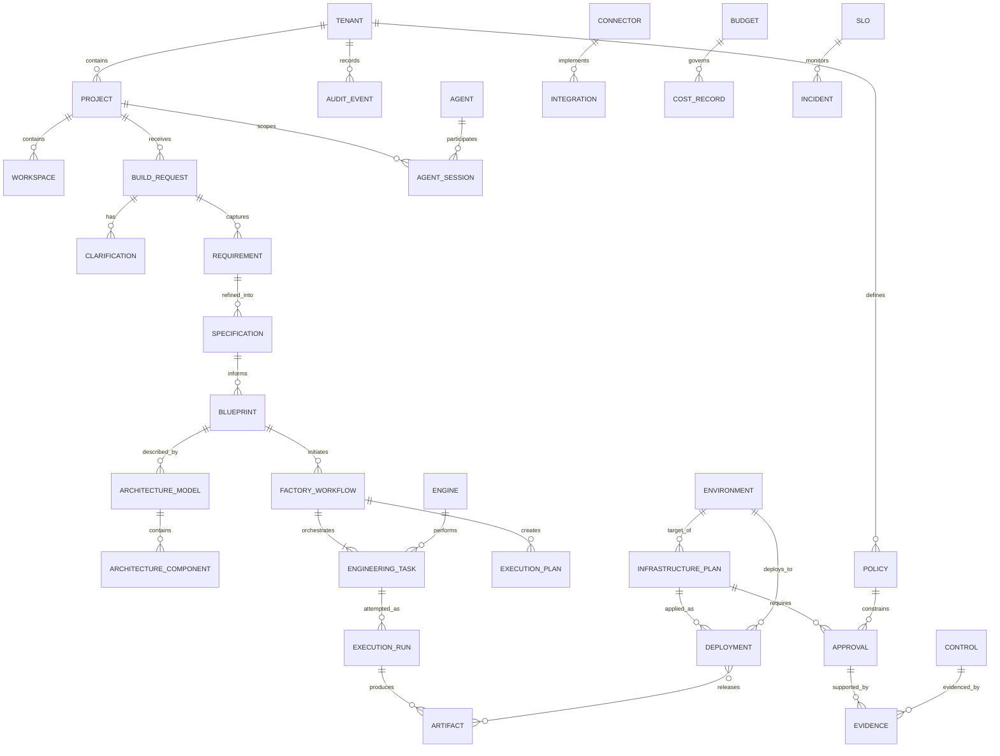

# EPF Canonical Logical ERD

**Version:** 0.1.0 — Draft  
**Notation:** Mermaid ER diagram. Logical relationship view, not a physical database schema.

## Core request-to-delivery path

## Relationship constraints

| Relationship | Cardinality | Integrity rule |
|---|---|---|
| Tenant → Project | 1:N | Project belongs to exactly one tenant |
| Project → BuildRequest | 1:N | Request is tenant/project scoped |
| BuildRequest → Clarification | 1:N | Clarification is append-only once answered |
| BuildRequest → Requirement | 1:N | Requirement retains source request |
| Requirement → Specification | N:M over versions | Specification records covered requirement references |
| Specification → Blueprint | 1:N | Blueprint pins exact specification version |
| Blueprint → FactoryWorkflow | 1:N | Workflow records exact blueprint version |
| FactoryWorkflow → EngineeringTask | 1:N | Task belongs to one workflow |
| EngineeringTask → ExecutionRun | 1:N | Each retry is a separate run |
| ExecutionRun → Artifact | 1:N | Artifact immutable by digest |
| Environment → InfrastructurePlan | 1:N | Plan targets one environment scope |
| InfrastructurePlan → Approval | 1:N | Approval binds exact plan digest and action |
| Deployment → Environment | N:1 | Deployment targets one environment |
| Subject → Policy | N:M | Evaluation records exact policy versions |
| Control → Evidence | N:M | Evidence may support multiple controls |

## Notes

- Envelope columns are omitted for readability.
- Relationship records should be explicit where attributes, temporal validity, provenance or authorization are needed.
- A workflow may contain a dependency DAG of tasks; dependency cycles are invalid.
- The same artifact may be consumed by multiple tasks or deployments; represent this with an artifact-reference association.
- Refine this ERD when API boundaries, event contracts and physical persistence are designed.
