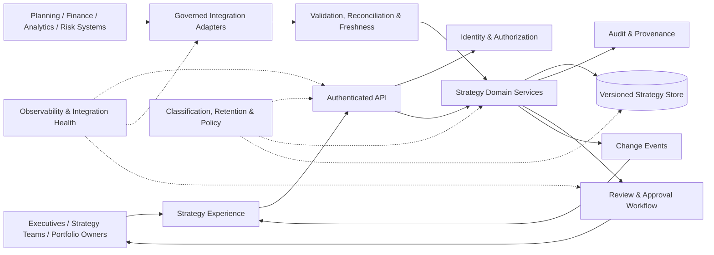

# Enterprise Strategy Factory — Target Architecture

## 1. Purpose and scope

This document describes a technology-neutral logical architecture for ESF. It defines the components and information flows needed to support governed strategy formation, portfolio alignment, execution review and organizational learning. It is a target design, not a description of deployed services.

## 2. Architectural principles

1. Preserve a clear link from strategy intent to evidence, decisions, investments and outcomes.
2. Separate descriptive evidence, derived analysis, recommendations and human decisions.
3. Keep accountable people—not automated scoring or AI—responsible for material strategic and funding decisions.
4. Treat source data as governed, scoped and potentially stale; preserve lineage and freshness.
5. Use explicit organization, strategy, portfolio and time-period scopes.
6. Version strategy records and relationship changes so historical decisions remain interpretable.
7. Make integrations observable, least-privileged, idempotent and explicit about failures.
8. Provide auditability and access controls as cross-cutting services.
9. Avoid binding the core domain model to one strategy methodology, planning vendor or data platform.

## 3. Logical architecture

### 3.1 Experience layer

Components: Strategy Command Center, Strategy Intake, Strategy Map, Initiative Portfolio, Scenarios & Signals, Execution & Outcomes, Governance & Risk, Insights & Learning.

Responsibilities:

- Present strategy at the appropriate organizational scope.
- Capture and display choices, objectives, initiative relationships, measures and decisions.
- Expose data source, owner, freshness, status and uncertainty.
- Support review, collaboration, approval and feedback flows.
- Distinguish prototype, sample, integrated and user-entered data.

### 3.2 Strategy domain services

Components:

- Strategy Workspace and Version Service
- Context, Evidence and Assumption Registry
- Choice and Decision Record Service
- Strategy Map and Alignment Service
- Portfolio and Investment Proposal Service
- Scenario and Signal Registry
- Objective, Measure and Outcome Service
- Review Cadence and Learning Agenda Service

Responsibilities:

- Maintain canonical domain entities and their relationships.
- Validate lifecycle transitions and required metadata.
- Calculate transparent structural indicators, such as missing owners or unlinked objectives.
- Preserve prior versions and decision context.

Any generated synthesis or prioritization should be a separately identified capability. It must not be embedded as an opaque side effect of domain updates.

### 3.3 Workflow and collaboration services

Components: Review Workflow, Approval Service, Notification/Task Service, Collaboration and Comment Service.

Responsibilities:

- Coordinate review cycles and decision checkpoints.
- Route requests according to configured scope and decision rights.
- Capture reviewer identity, decision, rationale, timestamp and applicable version.
- Escalate overdue or blocked decisions without changing the underlying strategy automatically.

### 3.4 Data and integration layer

Components: API Gateway, Integration Adapters, Import/Export Service, Event/Change Stream, Data Quality and Reconciliation Service.

Candidate systems of record include enterprise planning, financial planning, analytics, risk, project portfolio and collaboration systems. The authoritative source for each field must be explicitly configured; ESF should not silently overwrite source data.

Integration rules:

- Use read-only access by default during initial rollout.
- Grant write-back only through a separate review of scope, authorization, idempotency and audit requirements.
- Validate schemas, organizational scopes, timestamps and metric definitions.
- Preserve external identifiers, source system and synchronization timestamps.
- Surface partial syncs, stale data and failures to users and operators.

### 3.5 Trust, governance and operations layer

Components: Enterprise Identity Provider, Authorization/Policy Service, Classification and Retention Controls, Audit Ledger, Secrets Manager, Observability and Integration Health.

Responsibilities:

- Authenticate people and service identities and authorize access by role, record, organization and purpose.
- Enforce separation of duties for configured approvals.
- Record material changes and decisions with actor, timestamp, version and provenance.
- Apply retention and deletion policies to records and imported data.
- Monitor access, integrations, freshness, latency, failures and data-quality exceptions.

## 4. Logical component topology



## 5. Domain relationships

The core traceability path is:

```text
Organization / Scope
  └── Strategy Version
      ├── Intent and Strategic Choices
      │   ├── Evidence, Assumptions and Scenarios
      │   └── Decision Records
      ├── Pillars and Objectives
      │   └── Measures (definition → baseline → target → actual)
      └── Initiative Portfolio
          ├── Objective Contributions
          ├── Owners, Investment Proposals and Capacity
          ├── Dependencies and Risks
          └── Milestones, Outcomes and Review Decisions
```

Relationships should include type, scope, validity period, owner and provenance. A contribution relationship is a strategic hypothesis unless validated; the model must not imply causation merely because an initiative links to an outcome.

## 6. Canonical record envelope

An illustrative envelope for a strategy decision:

```json
{
  "id": "esf:decision:uuid",
  "type": "StrategicDecision",
  "schemaVersion": "1.0.0",
  "organizationScope": "business-unit-id",
  "strategyId": "esf:strategy:uuid",
  "strategyVersion": "2.1",
  "owner": "principal-id",
  "lifecycle": "approved",
  "decision": "prioritize-connected-journeys",
  "alternativesConsidered": ["channel-expansion", "service-consolidation"],
  "rationaleRefs": ["esf:evidence:uuid", "esf:assumption:uuid"],
  "approvals": ["esf:approval:uuid"],
  "effectiveAt": "ISO-8601",
  "reviewAt": "ISO-8601",
  "provenance": {
    "source": "strategy-review",
    "actor": "principal-id"
  }
}
```

This is a conceptual example, not a finalized API contract. Avoid including confidential narrative or unnecessary personal data in identifiers and event payloads.

## 7. Lifecycle and state transitions

Suggested strategy workspace states: `draft`, `framing`, `under_review`, `approved`, `active`, `refresh_due`, `superseded`, `archived`.

Suggested initiative states: `proposed`, `under_assessment`, `approved`, `active`, `paused`, `at_risk`, `completed`, `stopped`.

State changes should validate required fields and authority. For example, approval requires an authorized approver and a recorded decision; a scenario signal or automated indicator cannot transition a strategy or initiative to an approved or stopped state.

## 8. Identity, access and trust boundaries

Identity classes:

- **Human user:** Enterprise identity with organization and role claims.
- **Integration identity:** Service principal limited to named APIs, source systems and permitted data scopes.
- **Optional AI assistant:** Registered client whose access is bounded by the authenticated user, approved data policy and task purpose; it has no independent authority to approve decisions.

Authorization should consider subject, action, record, organization scope, sensitivity, purpose and approval status. Default to deny when scope or authority is ambiguous.

| Boundary | Risk | Controls |
|---|---|---|
| User → experience/API | Unauthorized access to confidential strategy | SSO, scoped authorization, session controls and audit |
| Source system → adapter | Overcollection, schema drift or incorrect organization mapping | Read-only scopes, schema validation, mapping review and reconciliation |
| Integration → strategy store | Stale or conflicting source updates | Source-of-record rules, idempotency, timestamps and explicit conflict handling |
| Optional AI → enterprise content | Disclosure, unsupported claims or instruction injection | Approved models, data minimization, source citations, output validation and human review |
| Reviewer → approval workflow | Self-approval or approval outside authority | Delegation rules, separation of duties and version-bound approval |
| Export → downstream audience | Accidental disclosure or loss of caveats | Classification, export authorization, provenance and included limitations |

## 9. Events and audit

Representative versioned events:

- `StrategyWorkspaceCreated`
- `StrategyVersionProposed`
- `EvidenceReferenceAdded`
- `AssumptionConfidenceChanged`
- `StrategicChoiceSubmitted`
- `StrategicDecisionRecorded`
- `ObjectiveRelationshipUpdated`
- `InitiativeInvestmentProposed`
- `ApprovalGranted` / `ApprovalRejected`
- `MeasureObservationImported`
- `ReviewCheckpointCompleted`
- `StrategyVersionSuperseded`
- `IntegrationSyncFailed`

Events should include an event ID, event type/version, organization scope, actor/service identity, entity/version reference, timestamp, correlation ID and source provenance. Sensitive content should remain in access-controlled records rather than copied broadly into event payloads. Audit records should be append-only under the applicable retention policy.

## 10. Operational qualities

- **Consistency:** Use stable identifiers, versioned schemas and explicit source-of-record rules.
- **Resilience:** Make imports idempotent, retry bounded transient failures and expose unreconciled records.
- **Freshness:** Store source timestamp and synchronization time; define staleness by data type.
- **Security:** Encrypt sensitive data in transit and at rest; rotate integration credentials and minimize scopes.
- **Observability:** Track API health, access denials, approval latency, sync freshness, data-quality errors and audit delivery.
- **Portability:** Keep domain semantics independent from vendor-specific planning or analytics schemas.
- **Recovery:** Define backup, restore, retention and deletion behavior for strategy records and provenance.

## 11. Deployment and integration decisions

Deployment topology, cloud provider, database, event infrastructure, identity product and AI provider remain open pending discovery. Resolve these decisions based on:

- Data residency and confidentiality requirements.
- Existing enterprise identity and records-management controls.
- Expected strategy and portfolio scale.
- Source systems and their integration contracts.
- Availability and recovery requirements for review cycles.
- Whether optional AI assistance is permitted for the relevant information classifications.

No live integration, write-back, model inference or funding workflow is implied by the standalone prototype.
